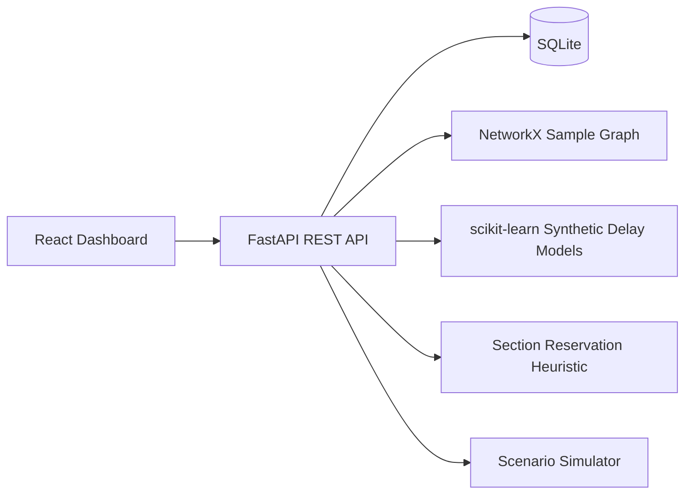

# RailFlow AI

**Smarter Railway Traffic. Fewer Delays. Safer Journeys.**

RailFlow AI is a local railway traffic simulation and decision-support prototype focused on an illustrative Indian corridor network. It combines a responsive React dashboard with a FastAPI backend, train operations, synthetic delay estimates, section-aware scheduling, conflict screening, scenario simulation and SQLite persistence.

> **Important:** This repository contains synthetic demonstration data. It is not connected to live Indian Railways systems, is not an authoritative Indian rail network map, and must not be used to dispatch or control trains. It has no signalling, interlocking, routesetting or train-control integration. Outputs are advisory demonstrations only and require qualified railway review.

## What is included

- Responsive command-center interface for desktop, tablet and mobile.
- Train operations: search, add, update priority/delay, and remove demo trains. Changes persist in SQLite.
- AI delay estimates and synthetic holdout metrics using scikit-learn baselines.
- Continuous model improvement from operator-verified arrival delay outcomes stored in SQLite.
- Section-reservation scheduling heuristic with track-capacity and minimum-headway constraints.
- Train-to-train conflict screening for estimated single-track overlap/headway and modeled multi-track capacity.
- Congestion proxy by modeled route-section usage.
- Alternate route comparison over the sample NetworkX graph.
- Reproducible what-if disruption simulations with saved scenario history.
- Analytics charts and a context-aware demo assistant.
- One-time setup/run scripts for Windows and macOS/Linux, plus Docker Compose deployment.

## Quick start — Windows

**Requirements:** Python 3.10+ and Node.js 20+ (npm is included with Node.js). Internet is needed for the first dependency installation.

1. Extract `RailFlow-AI.zip` to a normal folder, e.g. `C:\Projects\RailFlow-AI`.
2. Double-click **`setup_windows.bat`**. It creates the Python environment and installs backend and frontend packages.
3. When setup completes, it starts both servers and opens the dashboard.
4. Next time, double-click **`run_windows.bat`**.

Open these addresses if they do not open automatically:
- Dashboard: http://127.0.0.1:5173
- API health: http://127.0.0.1:8000/api/health
- Interactive API docs: http://127.0.0.1:8000/docs

Keep both terminal windows open while using the dashboard. Close them to stop the servers.

## macOS / Linux

Requirements: Python 3.10+, Node.js 20+, npm.

```bash
chmod +x setup_local.sh run_local.sh
./setup_local.sh       # first time only
./run_local.sh         # each time you want to launch
```

Then open http://127.0.0.1:5173. Press `Ctrl+C` in the run terminal to stop both services.

## Docker Compose (cross-platform)

Install Docker Desktop or Docker Engine with the Compose plugin, then run from the project root:

```bash
docker compose up --build
```

Open http://127.0.0.1:5173. The SQLite database is stored in the named `railflow_data` volume. Stop with `Ctrl+C`; use `docker compose down` to stop and remove containers. The named data volume remains unless explicitly removed with `docker compose down -v`.

## Manual setup

Backend terminal:

```bash
cd backend
python -m venv .venv
# Windows PowerShell: .venv\Scripts\Activate.ps1
# macOS/Linux: source .venv/bin/activate
pip install -r requirements.txt
uvicorn app.main:app --reload --host 127.0.0.1 --port 8000
```

Frontend terminal:

```bash
cd frontend
npm install
npm run dev
```

Vite proxies `/api` requests to `http://127.0.0.1:8000`. If the backend is on another host, update `frontend/vite.config.ts` and `frontend/nginx.conf` accordingly.

## Run backend tests

The backend suite includes API response-contract checks for the dashboard views. The frontend source is also syntax-parsed during development; a full Vite production build requires installing the pinned npm dependencies.

```bash
cd backend
python -m pytest -q
python -m compileall -q app
```

## Main API endpoints

| Method | Endpoint | Purpose |
|---|---|---|
| GET | `/api/health` | Health, storage and data mode |
| GET | `/api/overview` | Dashboard KPIs |
| GET/POST | `/api/trains` | List / add trains |
| PATCH/DELETE | `/api/trains/{id}` | Update / remove train |
| GET | `/api/network` | Illustrative network graph |
| GET | `/api/routes?origin=NDLS&destination=CSMT` | Up to three modeled paths |
| GET | `/api/predictions` | Delay estimates and model metrics |
| GET | `/api/learning` | Verified outcome count and learning status |
| POST | `/api/learning/feedback` | Save an actual arrival delay for a known train |
| POST | `/api/learning/retrain` | Refit after at least 10 verified outcomes |
| POST | `/api/optimize` | Section-reservation schedule proposal |
| GET | `/api/congestion` | Route-overlap congestion proxy |
| GET | `/api/conflicts?headway_min=8` | Train-to-train conflict screening |
| POST | `/api/simulate` | Run a synthetic disruption scenario |
| GET | `/api/scenarios?limit=20` | Saved simulation history |
| GET | `/api/recommendations` | Delay-review suggestions |
| GET | `/api/assistant?q=...` | Demo Q&A against current app state |

## Storage

SQLite is created automatically at `backend/data/railflow.sqlite3`. Train additions, edits and deletions, scenario run history, and verified arrival outcomes are persisted locally. The model automatically refits after each 20 new verified outcomes; manual refit is available after 10. Refitting scores model candidates on the generated holdout and then trains the selected model on generated examples plus the recorded outcomes. Model artifacts are local and excluded from Git. To choose another database path:

- Windows PowerShell: `$env:RAILFLOW_DB_PATH="C:\\RailFlowData\\railflow.sqlite3"`
- macOS/Linux: `export RAILFLOW_DB_PATH="$HOME/railflow-data/railflow.sqlite3"`

Set the variable before starting the backend. The database contains demo application data, not user accounts or production operational data.

## Technology stack

- Frontend: React 18, TypeScript, Vite, Recharts, Lucide icons, responsive CSS.
- Backend: Python, FastAPI, Pydantic, NetworkX, scikit-learn.
- Persistence: Python standard-library SQLite.
- Deployment: Windows scripts, shell scripts, Docker Compose.

## Known limitations

- The included 12 stations, 15 track sections and six seeded trains are a small illustrative sample, not a full Indian railway network.
- Delay-model training and metrics use generated synthetic examples; they are not real-world accuracy claims.
- Operator feedback only improves the model when actual arrival outcomes are entered and verified. It does not fetch live data or learn safely from unverified predictions.
- Scheduling is a deterministic heuristic, not an OR-Tools CP-SAT solver or certified timetable optimizer.
- Conflict screening estimates section intervals from scheduled departure, current simulated delay and average speed. It does not model signalling blocks, interlocking, route locking, platform occupation, braking curves, direction-specific infrastructure, temporary speed restrictions or official operating rules.
- The map is a schematic diagram, not a geographic India basemap.
- Authentication, RBAC, audit logging, production deployment hardening, WebSockets and integration with licensed real operational feeds are not implemented.
- Frontend production build is verified with `npm run build` in `frontend/` (TypeScript `tsc -b` plus `vite build`).

## Architecture



See `docs/DEVELOPMENT_REPORT.md` for implementation notes and test status.
